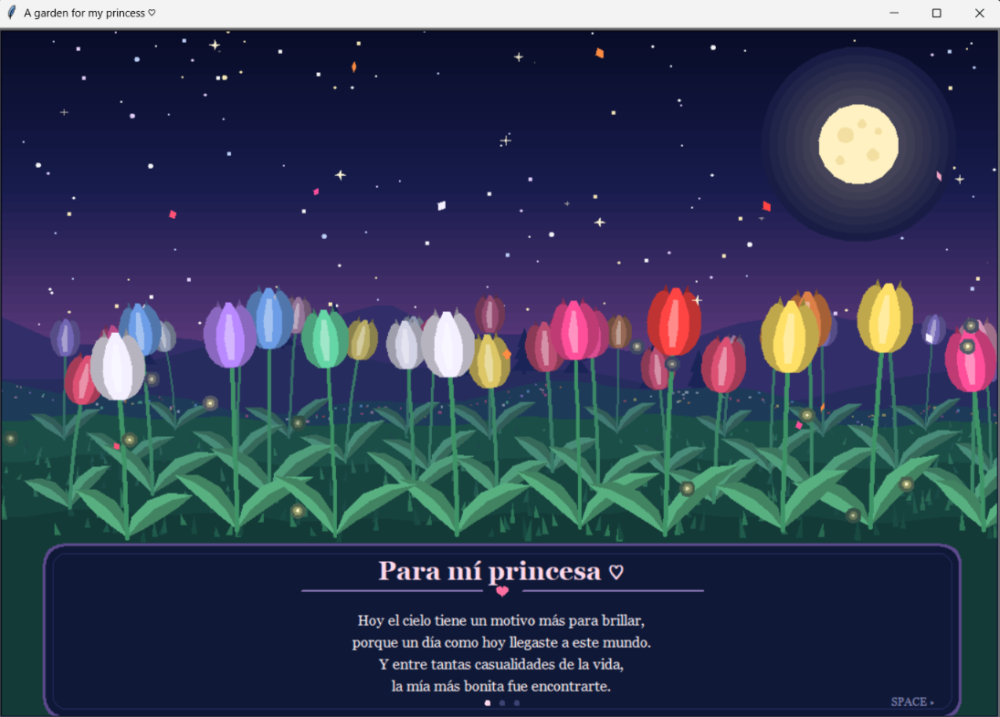
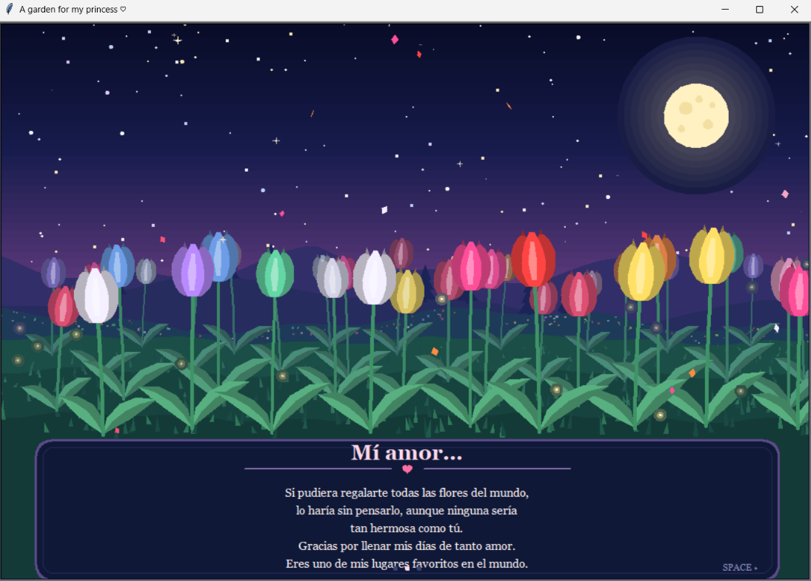
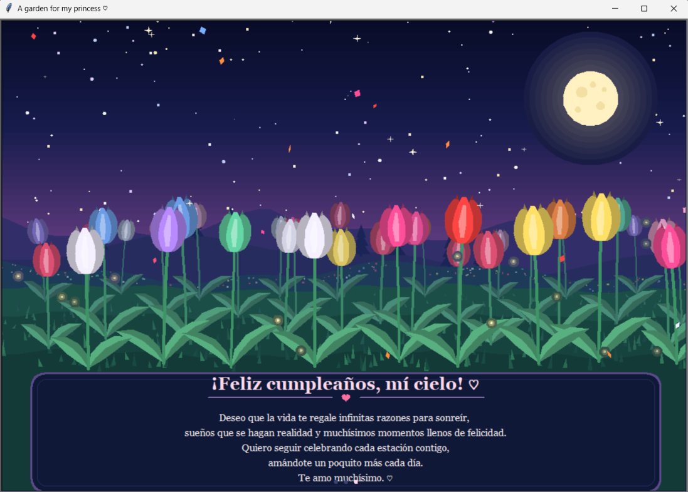

# A Garden for My Princess ♡

A little garden filled with tulips, starlight, and love. 🌷

This project is a romantic animated scene created with **Python Turtle**, featuring a beautiful field of colorful tulips swaying gently in the wind beneath a starry night sky.

More than just an animation, it is a little birthday dedication made with code, patience, and lots of love. ♡

## ✨ Features

- **Animated Tulips:** A colorful field of tulips gently swaying with the wind.
- **Night Sky:** A gradient sky with a glowing moon and hundreds of stars.
- **Dynamic Particles:** Falling flower petals, twinkling stars, and glowing fireflies.
- **Shooting Stars:** Occasional shooting stars crossing the night sky.
- **Floating Hearts:** Small hearts gently rising through the garden.
- **Romantic Messages:** Three personalized messages displayed sequentially with smooth fade-in transitions.
- **Depth and Perspective:** Multiple layers of flowers, hills, mountains, and trees create a sense of depth.

## 🖼️ Graphical Representation

The following folder contains visual references and a recording of the animation.

### Animation Preview

[Watch the animation (MP4)](graphical-representation/tulip.mp4)

### Screenshots

<p align="center">
  
  
  
</p>

## 🛠️ Technologies

- **Python 3**
- **Turtle Graphics**
- **Tkinter**
- Math and Random standard libraries

## 🚀 Getting Started

### Prerequisites

Make sure you have Python 3 installed on your computer.

The project uses Python's standard libraries, so no additional packages are required.

### Running Locally

1. Clone this repository:

   ```bash
   git clone https://github.com/laetg404/a-garden-for-my-princess.git
   ```

2. Navigate to the project directory:

   ```bash
   cd a-garden-for-my-princess
   ```

3. Run the Python script:

   ```bash
   python main.py
   ```

   Replace `main.py` with the actual name of the Python file if necessary.

## 🎮 Controls

- **SPACE:** Advance to the next romantic message.
- Messages also advance automatically after their display duration.
- The final message remains on screen.

## ⚙️ Customization

The animation includes several configurable parameters:

- `WIND_STRENGTH`: Controls the intensity of the wind.
- `TULIP_ROWS`: Sets the number of flower rows.
- `TULIP_COLUMNS`: Sets the number of tulips per row.
- `MESSAGE_DURATIONS`: Defines how long each message remains on screen.
- `FADE_SECONDS`: Controls the message transition duration.

## 💗 A Little Dedication

Made with Python, creativity, and lots of love.

*Because even a thousand flowers wouldn't be enough to express how beautiful you are.*

**For Valbb, my princess. Always. ♡**

---

<sub>Part of a collection of little projects created with love.</sub>

🌷
